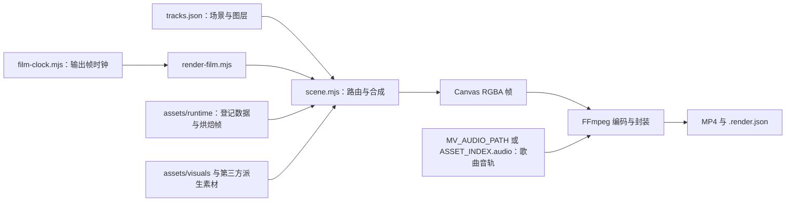

# 渲染架构

本工程使用 Node.js 与 `@napi-rs/canvas` 绘制二维动画，再将 RGBA 帧送入 FFmpeg 编码。人物主要由透明图片、局部表情、图层变换与镜头运动组成；背景和转场混合使用 Canvas 几何、SVG、登记数据及预处理图片。

主入口是 [`production/mv/render-film.mjs`](../production/mv/render-film.mjs)。从该入口的静态导入与再导出可达 54 个本地 JavaScript 模块，包括入口自身与 `spin-transition/src/` 中的两个 `.js` 模块。运行素材能否取得，与代码模块能否加载是两项独立条件；公开资源范围见 [许可说明](../LICENSING.md) 和 [逐文件素材清单](../assets/asset-licenses.json)。

## 数据如何变成视频



`render-film.mjs` 解析参数、计算整片输出时钟、扫描覆盖情况、建立一个可复用 Canvas，并按帧调用 `renderReference()`。Canvas 像素通过 FFmpeg 标准输入传递；绘图端遵守管道背压，避免把整片 RGBA 帧同时留在内存。

FFmpeg 接收固定宽高、固定帧率的 `rawvideo/rgba` 输入（始终 8-bit），输出像素格式由编码器与位深决定：默认 `libx264` 为 `yuv420p`，10-bit 只与 `libx265` 组合并输出 `yuv420p10le`。入口仍传 BT.709 三项色彩参数并启用 MP4 faststart；实测本机 FFmpeg n9.0.2 的 `libx264`/`libx265` 输出只有 `color_space=bt709`，`color_primaries` 与 `color_transfer` 为 `unknown`，参数意图不等于完整标记。带音轨时，歌曲另作 FFmpeg 输入，按选定区间定位，经过 `apad` 补足输出长度，再编码成 44.1 kHz、256 kbps AAC。完整渲染不会对歌曲做变速或变调。

## 编码与输入校验

[`encoding.mjs`](../production/mv/encoding.mjs) 是编码器注册表：`libx264` 8-bit `yuv420p`（`-preset`/`-crf`）、`libx265` 8-bit `yuv420p` 或 10-bit `yuv420p10le`（同为 `-preset`/`-crf`）、`av1_amf` 仅 8-bit `yuv420p`（`-quality`/`-b:v`）。其他编码器名、非法位深和不兼容组合在编码前以 `REFUSED` 退出 2；未知编码器不会套用 libx264 参数，显式 10-bit 也不会静默退回 8-bit。真实编码前用 `ffmpeg -hide_banner -encoders` 探测列表；列表存在不代表硬件后端能初始化，`--dry-run` 不探测。

`-pix_fmt` 只是请求：入口编码前读取 `ffmpeg -h encoder=<名称>` 的 `Supported pixel formats:`，目标格式不受支持时 `ERROR` 退出 1；编码后再用 ffprobe 核对实际 `pix_fmt`，不一致同样失败且不写 SRT/旁车。ffprobe 依次取 `FFPROBE_PATH`、所选 FFmpeg 同目录、PATH，缺失时只降级为 WARNING 并在旁车记 `actualOutput.verified: false`。

其余输入同样在启动时解析和校验：[`font-slots.mjs`](../production/mv/font-slots.mjs) 记录三个字体槽位的 `registered`/`missing-file`/`register-failed`/`not-configured` 状态并各打印一次 WARNING；[`audio-input.mjs`](../production/mv/audio-input.mjs) 解析 `MV_AUDIO_PATH` 或 `ASSET_INDEX.audio`，真实有声渲染要求文件存在，coverage/dry-run/`--no-audio` 不要求；[`srt.mjs`](../production/mv/srt.mjs) 只接受 `ja`/`bilingual`，非法值在编码前拒绝，并按输出窗口 `[AUDIO_SEEK, AUDIO_SEEK + n/fps)` 平移、裁剪并重新编号。

图像加载统一经过 [`load-asset.mjs`](../production/mv/load-asset.mjs)：缺图或损坏图片的错误会带 `assets/...` 相对路径（`Asset "<path>" is missing` / `cannot be decoded`），而不是只抛 canvas 的 URL/协议错误。渲染在编码失败时会删除本次新建的不完整输出，但不会删除运行前已存在的 `--out` 文件。

`--dry-run` 的 plan 与旁车记录对应关系为：plan 的 `encoder` 与旁车的 `encoding` 是同一结构；plan 的 `probe` 与 `formatProbe` 在 dry-run 为 `null`，旁车的 `encoderProbe`、`formatProbe` 与 `actualOutput` 保存真实的编码器列表、像素格式列表与 ffprobe 实测结果；`audio`、`fonts`、`subtitles` 两侧都记录。`subtitles.stats` 只有实际读取并裁剪 cue 后才有统计，规划阶段保持 `null`；片段内没有歌词时 `stats.output` 为 0、写出空 SRT，不视为错误。契约违反退出 2；运行期失败（FFmpeg 无法启动、编码器初始化失败、非零退出、像素格式不符）退出 1。

## 三种时间不要混用

[`film-clock.mjs`](../production/mv/film-clock.mjs) 以歌曲秒数作为输出时间。`scene.mjs` 的 `SOURCE` 保存参考画面时钟边界：

| 字段 | 值与含义 |
| --- | --- |
| `width`、`height` | 960×540，合成逻辑坐标 |
| `fps` | `24000 / 1001`，参考画面帧率描述 |
| `firstPTS` | 0.129 秒，最早可取的参考画面时刻 |
| `lastFramePTS` | 252.130 秒，最后有效画面取样时刻 |
| `endPTS` | 252.171 秒，用于决定覆盖至片尾的输出长度 |
| `SANA_SECONDS` | 252.006168 秒，歌曲时长常量 |

完整输出的第 `k` 帧按下面的关系取样：

```text
songSeconds = k / fps
sourcePTS = clamp(songSeconds - audioOffset, firstPTS, lastFramePTS)
outputFrames = ceil(max(SANA_SECONDS, endPTS + audioOffset) * fps)
```

默认 `audioOffset = 0.064`。60 fps 下输出为 15,135 帧、252.25 秒。开头在参考画面起点之前的输出帧保持 `firstPTS`，片尾越过最后画面时保持 `lastFramePTS`。这不是把参考视频按原帧率逐帧复制；绘图系统在新的 60 Hz 时间点计算位置、遮罩与表情。

`tracks.json` 和场景模块中的时间通常是**绝对 source PTS**。进入单个场景不会自动把时间归零，也不要再统一减去 0.129。个别 helper 会在内部把绝对时间转换成自己的归一化进度。`--audio-offset` 改变入口使用的时钟映射；`scene.mjs` 中另有按默认 64 ms 映射的 `sanaToReference()`，扩展调用时应明确选择哪个接口。

局部导出有两个不同接口：`--output-range A B` 使用整片的输出帧网格；`--range A B` 使用 source PTS。两者的帧数、音频定位与采样相位不同，详见 [复现方法](REPRODUCING.md)。

## 轨道与路由

[`tracks.json`](../production/mv/tracks.json) 包含 `coordinate`、`renderReady`、`scenes` 和 `transitions`。现有 `scenes` 有 54 项。每项至少有 `id`、`range`、`ready`，再通过 `opening`、`home`、`fashion`、`social` 等字段选择绘制系统。

`renderReference(pts, options)` 首先找到满足 `range[0] <= pts < range[1]` 的第一个场景。它将输出 Canvas 缩放到 960×540 逻辑坐标，再调用 `drawScene()`。`drawScene()` 的主要顺序是：

1. 保存上下文，应用 `scene.camera` 的平移、缩放与旋转。
2. 绘制符合时间条件的 `underlay`；它可以引用另一场景或纯色。
3. 绘制背景、背景序列或程序背景。
4. 根据场景字段调用对应的场景系统。
5. 绘制通用 `layers`、入口效果、社交界面及 `foregroundLayers`。
6. 恢复上下文；入口再处理跨场叠加与可选检查水印。

`transitions` 是跨场叠加接口，支持溶解、菱形、圆和矩形遮罩；当前轨道中的此数组为空。现有大多数转场由专用场景模块完成。新增叠加转场仍需要有效的底层场景，不能仅添加一条 `transitions` 就假定主场景路由存在。

朋友至广告的方形转场有单独的入口分支：`renderReference()` 在 `FRIEND_AD_SQUARE` 时间段内调用 `drawFriendAdSquare()`，分别回调朋友和车站场景，并抑制旧的朋友方块层。

## 场景系统导航

| 系统 | 主要模块与输入 |
| --- | --- |
| 镜子开场、片尾 | `opening-scenes.mjs`、`ending-native-helper.mjs`；读取 `runtime/opening-assets/` 的轨迹与表情登记，组合镜框、镜面、人物、反光及片尾遮罩。 |
| 标题与甜点 | `title-scenes.mjs`、`pink-rice-background.mjs`、`pinkdots-canvas.mjs`、`pattern-backgrounds-canvas.mjs`；名称中的 rice 为既有接口名，甜点底由 Canvas 绘制。 |
| 换装与片尾纸片 | `fashion-scenes.mjs`、`finale-fifo.mjs`；读取 `runtime/fashion/`。片尾十张纸片采用固定顺序与共享横移速度，画布裁切决定可见性。 |
| 电视、居家、摄影棚 | `tvroom-entry.mjs`、`r10-scenes.mjs`、`home-scenes.mjs`；摄影棚由 `studio-crew-mvp.mjs`、`studio-equipment-canvas.mjs` 和 `studio-lower-redraw.mjs` 组合人物、设备、补绘层与镜头。 |
| 相片链 | `photo-scenes.mjs`、`photo-room-canvas.mjs`；共享纸片间距与累计位移，保留单张纸片的局部姿态，绘制房间与绳子。 |
| 祈愿与回忆卡片 | `performance-scenes.mjs`、`track-smoothing.mjs`；对登记轨迹去尖峰、平滑并插值，表情采用局部区域合成。 |
| 杂志 | `magazine-scenes.mjs`、`magazine-smoke-canvas.mjs`；六封面采用共享运动模型，Canvas 烟雾遮罩控制逐步显现。 |
| 社交界面与手机 | `social-mvp-scenes.mjs` 再导出 `social-web-film.mjs`；基础 UI、透视与旧场景辅助分别在 `social-mvp-ui.mjs`、`social-mvp-project.mjs`、`social-ui.mjs`、`social-scenes.mjs`。 |
| 擦身与电车 | `interaction-scenes.mjs`、`train-entry-camera.mjs`、`train-seat-background-canvas.mjs`、`r52-scenes.mjs`；两阶段相机让人物、墙面、思绪链共用大世界移动。 |
| 朋友、广告、书店 | `friend-scenes.mjs`、`friend-color-transition.mjs`、`friend-layered-mask-native.mjs`、`friend-ad-square-transition.mjs`、`ad-code-mvp-scenes.mjs`、`ad-generated-plates.mjs`、`ad-scenes.mjs`、`bookshop-scenes.mjs`。 |
| 通用几何转场 | `color-grid-canvas.mjs`、`color-stripes-native.mjs`、`sparkle-native.mjs`、`r36-native.mjs`、`core-transition-scenes.mjs`；后者的 R67 使用登记的轮廓数据。 |
| 旋转转场 | `spin-transition-adapter.mjs` 调用 `spin-transition/src/core.js` 的时间采样与 `renderer-canvas2d.js` 的 Canvas 绘制。 |

## 图层、表情与 SVG

`drawLayer()` 对通用图层处理 `visible`、`keys`、`asset` 或 `sequence`、多边形/椭圆裁切、仿射矩阵、旋转和 `patches`。`at()` 对数值关键帧插值；右侧关键帧的 `ease` 可指定 `hold`、`smooth`，其他情况按线性插值。复杂相机和转场的 Bézier 曲线在对应 helper 中计算，不依赖 `at()` 自动解释任意曲线。

图片序列按绝对时间选择最近的已开始样本；循环序列必须给出结束时间。场景使用的二维矩阵、局部裁切框、图片母版尺寸与目标矩形是共同的登记关系。替换一张图片时，应一并检查这些参数，不能只修改文件名就假定手、脸或道具仍然对齐。

表情层通常只覆盖眼睛或嘴部。通用 `patches` 用 `source` 与 `destination` 矩形从变体取局部；专用场景还会用裁切和 alpha 蒙版保留固定身体。`studio-lower-redraw.mjs` 则在同一摄影棚变换下，保留上半身、通过渐变 alpha 与重新登记的下半身拼合。

公主镜框以 SVG 原件保存。`opening-scenes.mjs` 在内存中移除原 SVG 的镜面组，并按输出宽度提高栅格化密度，使已有镜面与反光层显露出来；磁盘上的 SVG 不被改写。其他道具也可由 SVG 解码后参与 Canvas 合成。提高输出分辨率会增加程序几何与 SVG 的栅格化密度，图片本身的原始细节仍由其母版决定。

## SNS 的多阶段合成

正式时间线消费的是预先烘焙的界面纹理，而不是每帧重新排版帖子。`assets/runtime/social-web-export/` 的主要输入为：

| 输入 | 消费方式 |
| --- | --- |
| `timeline.json` 与 `screen-*.webp` | 60 Hz 索引；1,049 个时间位置映射到 577 张不同屏幕纹理。界面逻辑宽 400、高 574，烘焙纹理为 1200×1722。 |
| `phone-timeline.json` 与 `phone-projected/front-*.webp` | 283 个时间位置映射到 229 张不同透视前面板；使用清单的 `start` 和 60 Hz 时间索引。 |
| `sidewall-once.png` | 手机后壁、侧面与阴影层；与前面板分别合成。 |
| `assets/third-party-derived/social-assets/foreground-thumb.png` | 独立前景手指，覆盖在手机层之上。 |

`social-web-film.mjs` 依次处理帖子、桥接、圆形揭示、斜手机、溶解到人物和持机人物。屏幕、手机前面板和手指的时钟需要协调，尤其不能用已经投影过的前面板再进行一次相同投影。

`preparePhoneHardware()` 提供手机几何预处理入口，会输出侧壁与前面板底图；完整帖子内容和屏幕序列不是运行时自动凭空生成的输入。替换 SNS 设计需要另外制作对应纹理、投影结果与清单，并保持约定的尺寸、时间起点和索引结构。

## 缓存、覆盖与扩展边界

`scene.mjs` 的图片缓存有 96 项容量控制；部分场景使用更小的图片缓存，SNS 保留最近一次纹理。动画运动大多由绝对时间直接求值，缓存用于解码、栅格化或固定图层预处理。新增实现应保持同一时刻可重复取样，并检查乱序取样是否影响结果。

`--coverage` 检查指定 fps 的整片采样帧能否路由，不读取每一张实际图片。零缺口表示这些取样点被覆盖，不等于所有连续实数时刻、全部外部输入或画面效果都已验证。`ready`、`tracks.renderReady` 与 `plan.json` 的 `render_ready` 是独立的登记字段；它们不能替代素材存在性检查或动态观看。

继续修改时，先从场景 `id` 找到实际调用的模块，再沿它读取的 JSON 与素材路径检查。修改共享坐标、相机或时钟会影响多个场景；单场景预览、接点检查和整片审看承担不同作用。具体运行命令与输入限制见 [REPRODUCING.md](REPRODUCING.md)。
